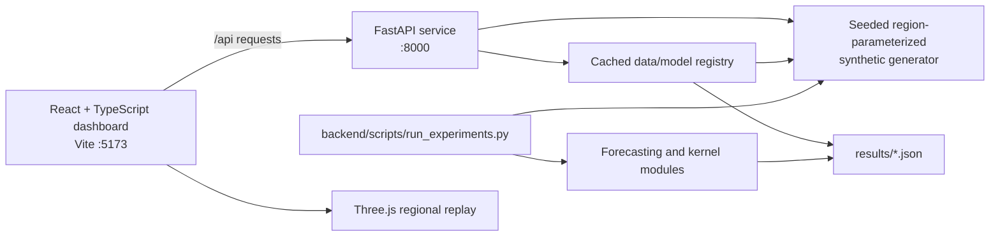

# Architecture

## Components



The browser requests data through the Vite `/api` proxy during local development. This is the application's local API, not a weather-data API: it provides health, region metadata, synthetic time series, stored experiment results, forecast traces, and kernel embeddings. The registry generates and caches synthetic region frames. The interactive `/api/predict/{region}` route accepts lags and covariates and runs only the proposed AR(24) + VQK model. XGBoost and LSTM forecasts in the replay are stored experiment outputs; those models are run by the separate experiment scripts, which write JSON artifacts under `results/` by default. The CSV loader is not yet wired into either path.

## Backend responsibilities

- `backend/app/data/synthetic.py`: deterministic hourly synthetic scenarios with fixed region parameters for Iberian solar (A), North-Sea wind (B), and mixed Texas (C). The parameters are not fitted to a documented observational dataset.
- `backend/app/data/loaders.py`: CSV-reading utility for user-supplied files; it is not connected to the API registry or experiment runner.
- `backend/app/forecasting/`: chronological dataset splits, AR(24), classical baselines, residual model, and metric/protocol code.
- `backend/app/quantum/`: circuit feature map, kernel implementations, kernel PCA, and noise experiments; these computations are classical simulations.
- `backend/app/services/registry.py`: cached data/model access and result artifact loading.
- `backend/app/api/`: HTTP routes and schemas.
- `backend/scripts/`: experiment, figure, paper-number export, and reproduction-verification entry points.

## Frontend responsibilities

The React application provides a 3-D view of saved forecast traces, regional and model selectors, interactive kernel embeddings, experiment tables, and method/data explanations. The status indicator checks the local API; it does not mean the weather or power data are live. All visuals are based on this repository's generated data and saved outputs.

## Data flow

```text
seed + region
    -> synthetic hourly series (2018-01-01 through 2025-12-31)
    -> chronological train / validation / test windows
    -> classical forecasts + kernel residual / separability studies
    -> JSON experiment artifacts in results/
    -> FastAPI endpoints
    -> browser charts and regional replay
```

The default API reads committed JSON files for benchmark pages. The kernel lab computes an embedding when requested. Regenerating results is an explicit experiment command, not a side effect of starting the dashboard. The data, model input contract, current limitations, and methodological references are documented in `experimental-status.md`.

## Interfaces and ports

| Component | Local address | Purpose |
|---|---|---|
| React/Vite | `http://127.0.0.1:5173` | Browser dashboard |
| FastAPI | `http://127.0.0.1:8000` | Data/API service |
| OpenAPI docs | `http://127.0.0.1:8000/docs` | Interactive API reference |
